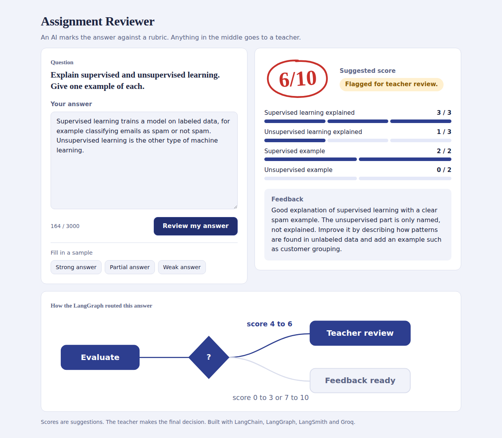
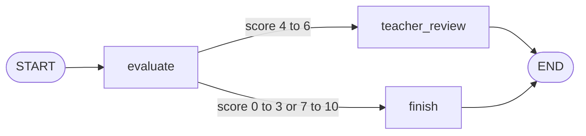

# Assignment Reviewer

An AI assignment reviewer using LangChain, LangGraph, LangSmith, and Groq.
It marks a student's answer against a rubric and sends borderline scores (4 to 6) to a teacher.
You can use it in the terminal (`python app.py`) or in the web interface (`uvicorn web:app --reload`).
Use Python 3.11 or 3.12.



## Web interface

After the setup below, start the web app and open http://127.0.0.1:8000:

```bash
uvicorn web:app --reload
```

The page shows the question, a box for the answer, the suggested score (out of 10), the rubric
breakdown, the feedback, and a diagram of which LangGraph branch the answer took.

| Method | Route | Description |
|--------|-------|-------------|
| GET | `/api/question` | The question and the rubric |
| POST | `/api/review` | Body `{"answer": "..."}`; returns score, breakdown, feedback, status and route |

## How the graph works



Rubric (10 marks): supervised explanation 0 to 3, unsupervised explanation 0 to 3,
supervised example 0 to 2, unsupervised example 0 to 2.

## Project structure

```
assignment-reviewer/
├── app.py          # LangChain + LangGraph reviewer (terminal)
├── web.py          # FastAPI web interface, reuses build_graph()
├── static/         # Frontend (index.html, style.css, app.js)
├── docs/           # Screenshot and presentation
├── requirements.txt
└── .env.example
```

## Setup (Windows, Command Prompt)

Open a terminal inside the extracted assignment-reviewer folder:

```bat
py -3.11 -m venv .venv
.venv\Scripts\activate
python -m pip install -r requirements.txt
copy .env.example .env
```

Use -3.12 instead if that is your installed Python version.
Edit .env to add your Groq API key from https://console.groq.com/keys.

```bat
python app.py
```

Type your answer on one line and press Enter (terminal version).

## macOS / Linux

```bash
python3 -m venv .venv
source .venv/bin/activate
python -m pip install -r requirements.txt
cp .env.example .env
# Edit .env to add your Groq key.
python app.py
```

## What each library does

- LangChain: combines the prompt and model, returning structured marks/feedback.
- LangGraph: evaluates the answer and routes scores 4–6 to teacher review.
- LangSmith: automatically traces the graph and model calls when enabled.

To enable LangSmith, get a key from https://smith.langchain.com/, set
LANGSMITH_API_KEY in .env, and change LANGSMITH_TRACING to true. Run the app
again. Open the assignment-review project in LangSmith to inspect the run.
Tracing records prompts and answers; use fictional student submissions.

## Sample answer

Supervised learning uses labeled data, such as emails labeled spam or not spam. Unsupervised learning finds patterns in unlabeled data, such as grouping customers by purchasing behavior.

## Scope

Scores are suggestions. Teacher review is an on-screen flag, with no saved
queue or approval flow. Model scores may vary. No API keys are included.
If your account cannot access the default model, set GROQ_MODEL to an available
Groq model supporting tool calling. API/network errors appear in the terminal.
Syntax and ZIP integrity checked; live API calls and dependency installation
were not tested in the packaging environment.
